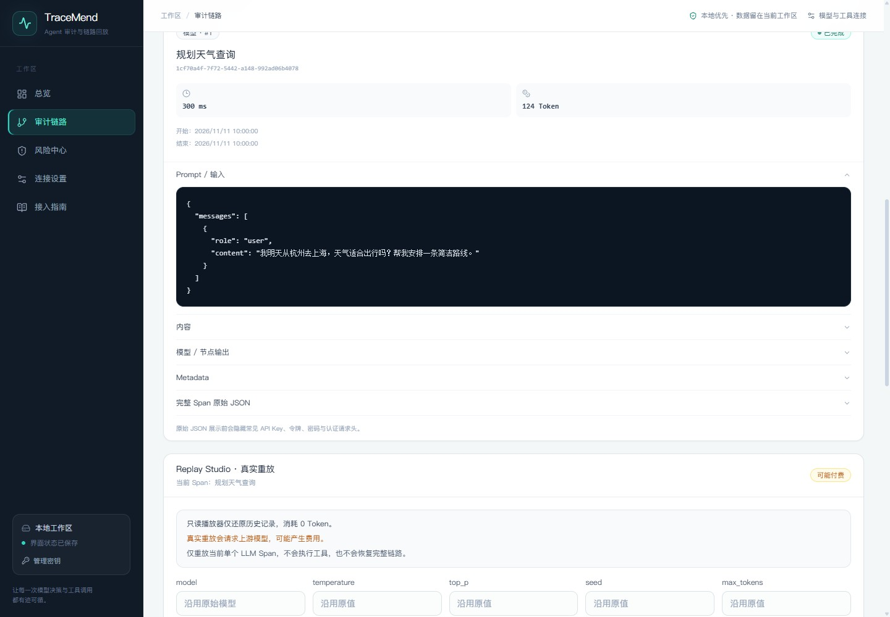

# TraceMend

> **让每一次 Agent 出错，都有迹可循。**

**TraceMend（迹修）** 是一个中文、本地优先、可自托管的 **Agent 审计与链路回放工作台**。它把模型调用、工具行为、Token、耗时与错误串成一条能看清、能复盘、能验证的证据链，并让你从历史 LLM Span 发起一次边界明确的重放实验，用新旧输出对比回答：**改了参数以后，结果到底变了什么？**

[核心功能](#功能) · [Replay Studio](#agent-链路回放器--replay-studio) · [快速开始](#快速开始) · [接入指南](#接入) · [验证记录](docs/verification.md)



## 为什么是 TraceMend

Agent 的问题往往不是日志里多了一行红色错误，而是“它为什么这样决定、哪一步开始偏离、修改后是否真的更好”。普通日志能告诉你请求发生过，却很难支撑一次完整的调试闭环。

| 调试现场 | TraceMend 提供的抓手 |
| --- | --- |
| 多轮模型与工具调用交织，看不清执行顺序 | Trace / Span DAG、时间线、原始输入输出与耗时统一呈现 |
| 工具报错、空结果、重复调用或回答缺少依据 | 免费确定性规则给出可复核的 Finding 与证据位置，不替人下事实结论 |
| 只想复盘历史，不想再烧一次 Token | ReplayBar 按 Span 播放、暂停、前后跳转，全程不请求模型、不执行工具 |
| 怀疑模型或采样参数有问题，却只能靠复制 Prompt 重试 | Replay Studio 从历史 LLM Span 重建请求，在当前路由上重放并生成 unified diff |
| 重试网络抖动，担心重复扣费或覆盖实验 | 服务端幂等预占与结果快照保证同键同体重试返回原结果，不再次请求上游 |
| 复盘后要归档、讨论或交接 | 评论、解决状态、中文 Markdown / PDF 报告保留完整证据 |

**它不只是“把 Trace 画出来”，而是把「发现异常 → 定位证据 → 重放单步 → 对比结果 → 留档」连成一条可操作的调试路径。** 这是本项目现阶段的产品组合方向，不声称全球首创，也不把单次对比包装成自动归因或自动修复。

## 适合谁

- 正在调试 LangChain、LangGraph、自定义 ReAct 或工作流 Agent 的开发者；
- 需要在本地保留 prompt、工具参数和审计证据的个人与小团队；
- 想用 OpenAI 兼容代理、MCP 或 REST ingest 接入，而不愿被某个 Agent 框架绑定的项目；
- 需要中文可视化复盘、实验血缘和报告导出的教学、竞赛与工程验证场景。

**TraceMend = Trace + Mend：先还原证据，再验证修正。** 产品原名 AgentTrace；为保持已有部署与接入兼容，`X-AgentTrace-Id`、数据库文件名、环境变量和浏览器存储键仍保留原名称。

**TraceMend 不是大模型，也不替代 Agent 或工具。** 它是代理与审计层。默认即可独立使用免费的确定性规则检测；二阶 LLM 检测默认关闭，只有显式配置并调用对应接口时才可能请求外部检测模型。真实重放只针对一个 LLM Span，可能产生上游费用，不会执行工具或恢复完整 Agent 链路。

## 功能

- **OpenAI 兼容代理**：`/v1/chat/completions` 非流式与 SSE 流式转发，保留上游状态码和响应，记录消息、工具调用、内容、Token、模型和异常。
- **网页连接设置**：在“连接设置”中配置默认模型、MCP 与二阶检测模型，保存后立即生效；密钥只写入被 Git 忽略的本地 `.env`，API 不回显。
- **轻量模型网关**：按模型名称和通配符匹配多条上游规则，支持优先级、408/425/429/5xx/网络错误自动切换、连续失败熔断、每日 Token 预算和按配置价格估算 USD 成本。
- **MCP 代理**：转发 JSON-RPC，记录 `initialize`、`tools/list`、`tools/call` 及工具结果或错误。
- **框架无关接入**：自定义 Agent 可直接 `POST /api/traces/ingest`，无需安装专用 SDK。
- **免费规则检测**：工具异常、空工具结果、参数/schema 问题、同名同参数重复调用、声明来源但无来源证据、工具证据未支撑的数字、明确状态冲突。
- **审计工作台**：搜索和筛选、链路 DAG、时间线与单步回放、原始输入/输出、Finding 证据、评论与解决状态。
- **Agent 链路回放**：零 Token 逐步回放历史 Span；选中单个 LLM Span 后可按当前路由付费重放并比较新旧输出，详见下节。
- **报告**：导出中文 Markdown 和 PDF 审计报告。
- **可选二阶 LLM 检测**：与免费规则分来源保存，不参与默认启动和自动分析。

风险 Finding 表示“需要复核的证据”，不代表系统断言内容一定错误；尤其是“未支撑数字”规则。

## Agent 链路回放器 / Replay Studio

链路详情页提供两种互补的回放方式：

- **零 Token 逐步回放（ReplayBar）**：按 Span `sequence` 播放、暂停、前后跳转或直接选择步骤，并同步 DAG、时间线与 Span 详情。它只读取已保存的审计记录，不请求模型、不执行工具，也不还原真实墙钟耗时。
- **单步 LLM 真实重放（Replay Studio）**：选中一个 LLM Span，确认可能产生费用后，使用**当前保存的路由与密钥**重新请求该次 `chat/completions`，可覆盖 `model/temperature/top_p/seed/max_tokens`。只重放所选 LLM Span；不会执行返回的 `tool_calls`、不重放其他 Span，也不恢复完整链路。历史请求的 URL 与客户端凭据不会被复用。

每次真实重放都必须携带 UUID 格式的 `Idempotency-Key`，重放 Trace 的 ID 为该键（按 UUID 规范化）。相同键与相同请求体重试会返回已保存结果，不重复请求上游；执行中或请求体变化会返回 409。重放遵守每日 Token 预算和当前路由的熔断/可重试回退（408/425/429/5xx/网络错误）：预算用尽返回 429，所有候选路由均处于熔断冷却期返回 503。

对比结果标记为 `same`、`different` 或 `failed`，逐项给出 content、reasoning、tool_calls 是否一致，以及内容相似度和 unified diff。进入上游调用后的 HTTP/网络/SSE 失败仍以 201 返回 failed Trace、failed Span、failed 对比和网关尝试记录，便于审计与幂等重试。界面展示与报告导出会隐藏常见密钥与 Bearer/`sk-` 字符串；历史请求顶层若含凭据字段会拒绝重放（409）。

使用方式：打开“审计链路”→ 进入任一 Trace → 用 DAG 下方的回放条零 Token 逐步查看 → 在 DAG、时间线或步骤下拉中选中 LLM Span → 在 Replay Studio 填写可选覆盖参数并确认费用 → 查看新旧输出、差异和归因提示，必要时跳转到独立的重放 Trace。单次一致或差异不能单独证明模型随机性或幻觉成因，需结合多次实验与事实评估。接口字段、状态码和安全边界见 [API 数据契约](docs/api-contract.md)。

## 架构

```text
Agent / OpenAI SDK / LangChain / MCP Client
                    │
                    ▼
        FastAPI 透明代理与 REST API
          ├─ Trace / Span 归一化
          ├─ 模型路由 / 预算 / 熔断 / 成本估算
          ├─ 免费规则（默认独立可用）
          ├─ 二阶 LLM 检测（默认关闭）
          └─ SQLAlchemy + SQLite 本地持久化
                    │
                    ▼
       React + TypeScript 中文审计工作台
       DAG / 时间线 / Finding / 评论 / 报告
```

生产部署中，Nginx 提供前端静态文件和 SPA fallback，并将 `/api/`、`/v1/`、`/mcp` 反向代理到后端；SSE 路径关闭代理缓冲。后端应用启动时自动建表，无需另行执行迁移命令。

## 快速开始

### Docker Compose

前置条件：Docker Engine 与 Docker Compose v2。

```bash
cp .env.example .env
# 按需编辑 .env；仅本地审计和免费规则不需要任何 API key
docker compose up --build
```

- 审计工作台：<http://127.0.0.1:3000>
- 后端 API：<http://127.0.0.1:8000>
- 健康检查：<http://127.0.0.1:8000/api/health>

启动后可直接打开“连接设置”网页配置模型与 MCP；非敏感的网关策略保存在 SQLite，密钥写入本地 `.env` 并立即生效。也可继续手动编辑 `.env`。

Compose 默认仅将端口绑定到 `127.0.0.1`。网页保存的连接配置写入持久化的 `data/.env`，初始 `.env` 以只读方式挂载；`data/.env` 中的同名配置在重启后优先，`ADMIN_KEY` 仍由 Compose 环境显式管理。`data/` 已被 Git 忽略。如需对外提供服务，必须显式修改 `ports` 绑定，并务必同时设置强 `ADMIN_KEY`、在入口启用 TLS、在可信网关或网络层配置上游地址白名单及代理客户端访问控制。**设置 `ADMIN_KEY` 不会保护 `/v1` 和 `/mcp`**：这两个协议代理无论是否设置管理密钥，都必须由反向代理、网关鉴权或网络 ACL 限制访问；应用也尚未实现上游地址白名单，不要将未鉴权代理直接暴露到公网。

前端 Nginx 通过 `client_max_body_size 20m` 将经前端代理的请求体上限设为 20 MiB，超限请求会由 Nginx 拒绝；直接访问后端端口不经过这一前端代理限制。

SQLite 文件持久化在宿主机 `./data/agenttrace.db`。前端等待后端健康后启动。停止服务：

```bash
docker compose down
```

`down` 不删除 `./data`。构建只复制后端应用、前端源码和必要构建配置，不复制 `.env`、`data/` 或 `node_modules/`。

### 本地开发

要求 Python 3.11+ 和 Node.js 20+。分别开两个终端：

```bash
cd backend
python -m pip install -r requirements.txt
uvicorn app.main:app --host 127.0.0.1 --port 8000
```

```bash
cd frontend
npm install
npm run dev -- --host 127.0.0.1 --port 3000
```

本地默认数据库为 `sqlite:///./data/agenttrace.db`，路径相对于后端工作目录；请先创建 `backend/data/`（或设置自己的 `DB_URL`）。也可通过环境变量加载根目录 `.env` 中的配置，不要把密钥写进源码。

### 写入演示数据

后端启动后执行，脚本只使用 Python 标准库：

```bash
python scripts/seed_demo.py
```

脚本通过真实 `POST /api/traces/ingest` 创建两条带 `demo` 标签的数据：

1. 天气与旅行工具链：用户问题、两轮 LLM 规划、天气和路线工具、结构化工具返回及最终回答。
2. 虚构的“普津汉大学”校史问答：三次相同参数检索、空返回、无来源引用及多个未支撑数字，用于观察风险证据。

演示数据通过 API 写入，不是前端硬编码。固定 UUID 使重复执行按 ingest 幂等规则 upsert。若设置了 `ADMIN_KEY`，脚本会读取同名环境变量。

## 配置

复制 `.env.example` 后按环境修改：

| 变量 | 默认值 | 用途 |
|---|---|---|
| `DEFAULT_UPSTREAM_BASE` | `https://api.openai.com/v1` | OpenAI 兼容代理的默认上游 |
| `DEFAULT_UPSTREAM_MODEL` | 空 | 请求未提供模型时使用的默认模型 |
| `DEFAULT_UPSTREAM_KEY` | 空 | 客户端未提供 Authorization 或使用保留占位 `agenttrace` 时使用的默认上游密钥；显式直连不替换 |
| `DEFAULT_MCP_UPSTREAM` | 空 | 默认完整 MCP URL；也可逐请求覆盖 |
| `DEFAULT_MCP_KEY` | 空 | 客户端未提供 Authorization 时使用的 MCP 密钥 |
| `GATEWAY_DAILY_TOKEN_BUDGET` | `0` | OpenAI 代理每日 Token 软预算；按已落库用量检查，不做并发预留；0 不限 |
| `GATEWAY_FAILURE_THRESHOLD` | `2` | 路由连续失败熔断阈值 |
| `GATEWAY_COOLDOWN_SECONDS` | `30` | 熔断冷却秒数 |
| `DEFAULT_INPUT_PRICE_PER_MILLION` | `0` | 默认上游每百万输入 Token 的估算 USD 价格 |
| `DEFAULT_OUTPUT_PRICE_PER_MILLION` | `0` | 默认上游每百万输出 Token 的估算 USD 价格 |
| `DB_URL` | `sqlite:///./data/agenttrace.db` | SQLAlchemy 数据库 URL；Compose 固定使用 `/data` |
| `ENABLE_LLM_CHECK` | `false` | 是否允许二阶 LLM 检测，默认关闭 |
| `CHECK_MODEL_BASE` | `https://api.openai.com/v1` | 可选检测模型的 OpenAI 兼容 base URL |
| `CHECK_MODEL_KEY` | 空 | 可选检测模型密钥 |
| `CHECK_MODEL_NAME` | `gpt-4o-mini` | 可选检测模型名称 |
| `CHECK_MODEL_TIMEOUT` | `60` | 可选检测模型请求超时秒数 |
| `ADMIN_KEY` | 空 | 设置后，除健康检查外的 `/api/*` 需要 `X-Admin-Key`；只能使用 ASCII 字符 |

`.env` 被 Git 忽略，`.env.example` 不含真实密钥。

### 网页配置与轻量网关

“连接设置”页集中管理默认模型、MCP、二阶检测、路由和成本。路由按 `fnmatch` 模型通配符匹配，数字优先级越小越先尝试；请求显式携带 `X-Upstream-Base` 时保持旧行为，不经过网关路由、预算和熔断。

- 对 408、425、429、5xx 和网络错误尝试下一路由；其他 4xx（含 400、401、403、404）不重试。连续失败达到阈值后临时熔断，可在网页手动重置。
- 认证头转发：路由配置了 `api_key` 时使用该密钥覆盖客户端 `Authorization`，并清除 `api-key`、`x-api-key`、Cookie、token/secret/signature 等其他客户端凭据头。只有首个候选路由可在未配置密钥时透传调用方凭据；故障切换到后续候选时一律清除这些凭据，备用路由需要自己的 `api_key`，避免跨服务商泄露。`DEFAULT_UPSTREAM_KEY` 只作用于默认上游，且仅当客户端未提供 `Authorization` 或使用保留占位 `agenttrace` 时替换；显式 `X-Upstream-Base` 直连始终原样透传，不注入服务端密钥。
- 每日预算按 UTC 当天 `[00:00, 次日 00:00)` 内每次 `openai-proxy` 或 `replay` LLM Span 的 `total_tokens` 统计，而不是按聚合 Trace 的首次开始时间；跨天复用 Trace ID 不会漏计，未来时间戳也不会计入今天。超出后返回 429，设为 0 表示不限。
- 成本按实际 usage 与配置的每百万 Token USD 单价估算；未配置价格或上游未返回 usage 时不产生可靠成本值。
- 流式响应在收到上游响应头前可切换路由；开始向客户端发送 SSE 后不再重试，以免拼接受损响应。下游主动停止或断开会记录未完成 Trace 并完成资源清理，但不会把健康上游计入失败熔断。
- 当前不包含相同 Prompt 缓存、多用户 Quota 或完整 LiteLLM 协议适配。

## 接入

### OpenAI Python SDK：只改 `base_url`

将 SDK 的 `base_url` 指向 TraceMend，并用 `X-Upstream-Base` 选择真实上游；业务代码、模型名和消息结构不变。API key 会先发送给所配置的 TraceMend，再转发给上游，因此只应使用可信实例；连接远程实例必须使用 TLS（`https`）。

```python
import os
from openai import OpenAI

client = OpenAI(
    api_key=os.environ["OPENAI_API_KEY"],
    base_url="http://127.0.0.1:8000/v1",
    default_headers={"X-Upstream-Base": "https://api.openai.com/v1"},
)
response = client.chat.completions.create(
    model="gpt-4o-mini",
    messages=[{"role": "user", "content": "你好"}],
)
print(response.choices[0].message.content)
```

可运行完整示例（会请求真实上游并产生相应费用）：

```bash
python -m pip install openai
read -rsp '真实上游 API key: ' OPENAI_API_KEY; export OPENAI_API_KEY; echo
python examples/openai_demo.py
```

也可通过请求头 `X-AgentTrace-Id` 指定 UUID，以串联调用；响应头同名返回 Trace ID。未设置 `X-Upstream-Base` 时使用 `DEFAULT_UPSTREAM_BASE`。

### LangChain：只改 `base_url`

```python
import os
from langchain_openai import ChatOpenAI

llm = ChatOpenAI(
    model="gpt-4o-mini",
    api_key=os.environ["OPENAI_API_KEY"],
    base_url="http://127.0.0.1:8000/v1",
    default_headers={"X-Upstream-Base": "https://api.openai.com/v1"},
)
print(llm.invoke("你好").content)
```

流式调用仍使用 LangChain 原有的 `.stream(...)`；TraceMend 在转发 SSE 的同时记录链路。

### MCP：`X-MCP-Upstream`

把 MCP 客户端的 POST 地址改为 `http://127.0.0.1:8000/mcp`，添加完整上游 URL：

```http
X-MCP-Upstream: http://127.0.0.1:9000/mcp
```

标准库示例：

```bash
export MCP_UPSTREAM_URL='http://127.0.0.1:9000/mcp'
export MCP_TOOL_NAME='get_weather'
python examples/mcp_client.py
```

未提供请求头时使用 `DEFAULT_MCP_UPSTREAM`。`/mcp/{path}` 用于需要额外路径的 MCP 服务。

### 自定义 Agent：主动 ingest

上报一个 Trace 及其有序 spans 即可，字段详见 [`docs/api-contract.md`](docs/api-contract.md)：

```bash
curl -X POST http://127.0.0.1:8000/api/traces/ingest \
  -H 'Content-Type: application/json' \
  -d '{
    "trace": {
      "name": "我的 Agent",
      "source": "custom-agent",
      "status": "completed",
      "input": {"messages": [{"role": "user", "content": "查询天气"}]},
      "output": {"content": "明天 25°C"},
      "started_at": "2026-11-11T10:00:00Z",
      "ended_at": "2026-11-11T10:00:02Z",
      "tags": ["my-agent"]
    },
    "spans": [{
      "sequence": 0,
      "kind": "user",
      "name": "用户提问",
      "status": "completed",
      "content": "查询天气"
    }]
  }'
```

`user`、`llm`、`tool`、`tool_result` 等 span 使用 `parent_span_id` 组成 DAG；工具返回的 `parent_span_id` 指向对应工具调用。可附 `tool_schema`、`tool_arguments`、`tool_result`、Token 与 metadata。

## 数据隐私与安全边界

- Trace、prompt、模型输出、工具参数、工具结果、Finding 和评论默认保存在本地 SQLite；这些数据本身可能含敏感信息，请按日志级别保护 `./data` 和导出报告。
- 上游与 MCP `Authorization` 只用于当次代理转发，不作为审计内容写入数据库；`X-Admin-Key` 也不会转发给上游。网页和路由密钥保存在被 Git 忽略的 `.env`（Compose 为 `data/.env`），接口只返回“是否已配置”，不会回显密钥。
- `X-Upstream-Base` 和 `X-MCP-Upstream` 能把数据发送到指定服务。只允许可信客户端访问代理，部署到共享环境时应增加网络访问控制、TLS 和上游地址白名单。
- `ADMIN_KEY` 保护管理 API，不是上游 API key，也不替代公网身份认证方案。`ADMIN_KEY` 只能使用 ASCII 字符（HTTP 请求头限制），非 ASCII 配置会在启动时直接报错。前端收到 401 会自动打开“管理密钥设置”，验证后只把密钥保存在当前标签页的 `sessionStorage`，并在 API 请求和报告下载中附带 `X-Admin-Key`。
- `ADMIN_KEY` **不保护** `/v1` 与 `/mcp` 协议代理；这两个入口需要由反向代理、网络 ACL 或网关鉴权限制访问。
- 免费规则在本地运行，不需要外网。只有显式启用并调用二阶 LLM 检测时，检测所需内容才会发往配置的检测模型服务。
- `DELETE /api/traces/{id}` 删除本地审计记录；宿主机备份、已导出报告和上游服务商的数据需分别管理。

## API 一览

管理 API 在设置 `ADMIN_KEY` 后需要请求头 `X-Admin-Key`（健康检查除外）。前端遇到 401 会自动提示输入密钥并重载当前页面；也可以用浏览器标签页内的密钥按钮手动设置或清除。

| 方法与路径 | 说明 |
|---|---|
| `GET /api/health` | 服务、数据库状态与版本 |
| `GET /api/traces?q=&status=&risk=&tag=&from=&to=&page=&page_size=` | 分页、搜索和筛选 Trace |
| `GET /api/traces/{id}` | Trace、按 sequence 排序的 spans、findings、comments |
| `DELETE /api/traces/{id}` | 删除本地 Trace 及关联记录 |
| `POST /api/traces/ingest` | 框架无关 Trace/Span 批量接入，幂等 upsert 并运行规则 |
| `POST /api/traces/{id}/spans/{span_id}/comments` | 针对 Span 添加评论/标注 |
| `POST /api/traces/{id}/comments` | 针对 Trace 添加评论/标注 |
| `PATCH /api/comments/{id}` | 更新评论内容或 `open/resolved` 状态 |
| `POST /api/traces/{id}/reanalyze` | 重新运行免费规则 |
| `POST /api/traces/{id}/spans/{span_id}/replay` | 单步 LLM 真实重放；需 UUID `Idempotency-Key`，可能产生费用，详见 API 契约 |
| `POST /api/traces/{id}/llm-check` | 显式执行可选二阶 LLM 检测；未启用/未配置返回 409 |
| `GET /api/traces/{id}/report.md` | 下载 Markdown 报告 |
| `GET /api/traces/{id}/report.pdf` | 下载 PDF 报告 |
| `GET /api/stats?days=30` | Trace、错误、风险、Token、耗时、模型、成本与预算统计 |
| `GET /api/settings` | 读取网页连接设置；只返回密钥是否已配置 |
| `PUT /api/settings` | 保存连接、预算、熔断与价格配置并立即刷新运行时 |
| `POST /api/settings/test` | 测试 OpenAI、检测模型或 MCP 连接 |
| `GET /api/gateway/routes` | 读取模型路由及熔断状态 |
| `POST /api/gateway/routes` | 创建模型匹配与上游路由 |
| `PATCH /api/gateway/routes/{id}` | 更新路由、价格、优先级或启用状态 |
| `DELETE /api/gateway/routes/{id}` | 删除路由并清除其独立密钥变量 |
| `POST /api/gateway/routes/{id}/reset` | 手动重置熔断状态 |
| `POST /v1/chat/completions` | OpenAI 兼容非流式/SSE 透明代理 |
| `POST /mcp`、`POST /mcp/{path}` | MCP JSON-RPC 透明代理 |

## 测试与真实全流程验收

后端和前端测试：

```bash
cd backend
python -m pip install -r requirements-dev.txt
python -m pytest -q
python -m ruff check .
```

```bash
cd frontend
npm test -- --run
npm run typecheck
npm run build
```

检查部署/演示脚本语法：

```bash
python -m py_compile scripts/seed_demo.py scripts/e2e_smoke.py examples/openai_demo.py examples/mcp_client.py
```

后端已在 8000 端口运行时，执行真实端到端验收：

```bash
python scripts/e2e_smoke.py
```

该脚本会启动两个仅监听 `127.0.0.1` 随机端口的本地 HTTP 模拟上游，**不访问外网、不需要 key**，实际完成：

1. OpenAI 非流式代理及响应标记、`X-AgentTrace-Id` 检查。
2. OpenAI SSE 流式代理：上游发出首个含标记的 `data` chunk 后暂停，客户端必须在放行及上游响应结束前逐行收到它，再检查完整内容与 `[DONE]`。
3. MCP `tools/call` 代理及工具返回检查。
4. 轮询详情 API，断言 spans、内容和 usage 已落库，并检查 MCP 工具名、参数和结果。
5. 下载 Markdown/PDF，检查 Markdown 标题与 PDF `%PDF` 魔数，保存到 `artifacts/`。

默认保留三条验收 Trace 供界面查看；无论验收成功或失败都要尝试删除本次已创建的 Trace，请使用：

```bash
python scripts/e2e_smoke.py --cleanup
```

如启用管理鉴权，先设置 `ADMIN_KEY` 环境变量。脚本任一步失败都会以非零状态退出；`--cleanup` 会尝试清理全部本次 Trace，清理失败不会掩盖原始验收异常。

本机已执行的测试、浏览器验收、Hermes 接入和未执行项记录在 [`docs/verification.md`](docs/verification.md)。

## 路线图

- 相同请求缓存、按用户/API Key 配额与更细粒度的路由策略。

- 更多 Agent 框架的一键适配与 OpenTelemetry 导入。
- 可配置上游白名单、保留周期和审计数据脱敏策略。
- 更细的规则配置、误报反馈与团队权限。
- 更多报告模板和外部工单系统集成。

路线图是后续方向，不表示这些能力已经完成。

## 字体许可

PDF 报告内嵌 Noto Sans SC 字体子集，字体文件位于 `backend/assets/fonts/`，使用 SIL Open Font License 1.1；许可全文见同目录 `OFL.txt`。容器构建会一并复制该字体目录，因此 Linux 环境无需安装额外中文字体。

## License

[MIT License](LICENSE)

Copyright (c) 2026 TraceMend contributors

Permission is hereby granted, free of charge, to any person obtaining a copy of this software and associated documentation files (the “Software”), to deal in the Software without restriction, including without limitation the rights to use, copy, modify, merge, publish, distribute, sublicense, and/or sell copies of the Software, and to permit persons to whom the Software is furnished to do so, subject to the following conditions:

The above copyright notice and this permission notice shall be included in all copies or substantial portions of the Software.

THE SOFTWARE IS PROVIDED “AS IS”, WITHOUT WARRANTY OF ANY KIND, EXPRESS OR IMPLIED, INCLUDING BUT NOT LIMITED TO THE WARRANTIES OF MERCHANTABILITY, FITNESS FOR A PARTICULAR PURPOSE AND NONINFRINGEMENT. IN NO EVENT SHALL THE AUTHORS OR COPYRIGHT HOLDERS BE LIABLE FOR ANY CLAIM, DAMAGES OR OTHER LIABILITY, WHETHER IN AN ACTION OF CONTRACT, TORT OR OTHERWISE, ARISING FROM, OUT OF OR IN CONNECTION WITH THE SOFTWARE OR THE USE OR OTHER DEALINGS IN THE SOFTWARE.
